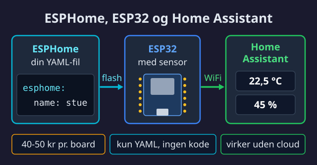
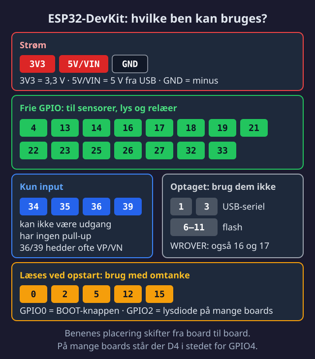

import { Steps, Aside, Tabs, TabItem, Card, CardGrid, Badge } from '@astrojs/starlight/components';

<Badge text="Let" variant="success" /> <Badge text="20 min" variant="note" /> <Badge text="50 kr" variant="caution" />


ESP32 er en mikrocontroller - en lille computer der kan måle ting, styre ting, og snakke med dit WiFi. Sammen med ESPHome bliver det nemt at lave dine egne smart home enheder.



## 📋 Forudsætninger

Før du starter, skal du have:

- ✅ [Home Assistant kørende](/da/home-assistant/)
- ✅ En computer med USB-port
- ✅ Chrome eller Edge browser (til USB flash)

## 🤔 Hvad er ESPHome?

ESPHome er software der kører på din ESP32. Du beskriver hvad den skal gøre i en simpel YAML-fil, og ESPHome klarer resten.

**Fordele:**
- Ingen Arduino IDE eller C++ programmering
- Direkte integration med Home Assistant
- Trådløse opdateringer (OTA)

## 🛒 Vælg dit board

| Board | Pris | Anbefalet til |
|-------|------|---------------|
| **ESP32-WROOM-32 DevKit** | 40-50 kr | ⭐ Begyndere (start her) |
| ESP32-C3 Super Mini | 25 kr | Små projekter |
| ESP32-S3 | 60 kr | Displays, mere RAM |

<Aside type="tip">
Start med en **WROOM-32 DevKit**. Den er bred nok til at se hvad du laver, og alle vores guides bruger den.
</Aside>

### ESP32 Pinout oversigt



## ⚙️ Installer ESPHome Add-on

<Steps>
1. **Åbn Home Assistant** og gå til **Indstillinger** → **Apps** (hed tidligere **Add-ons**)

2. Åbn butikken (nederst til højre)

3. Søg efter **"ESPHome"** og klik på den

4. Klik **Installer** og vent (1-2 minutter)

5. Slå **"Start ved opstart"** og **"Vis i sidebar"** til

6. Klik **Start**
</Steps>

<Aside type="note">
ESPHome ikonet vises nu i din sidebar til venstre.
</Aside>

## 🔌 Opret din første enhed

<Steps>
1. **Åbn ESPHome** fra sidebaren

2. Klik **+ NEW DEVICE**

3. Klik **Continue** (ignorer browser-flash for nu)

4. **Navngiv enheden** - f.eks. `test-sensor`
   
   <Aside type="caution">
   Brug kun små bogstaver, tal og bindestreger. Ingen mellemrum eller æøå.
   </Aside>

5. Vælg **ESP32** som device type

6. Klik **Skip** (vi flasher manuelt bagefter)
</Steps>

## 📝 Konfigurer enheden

Klik på **EDIT** på din nye enhed og erstat indholdet med:

```yaml title="test-sensor.yaml"
esphome:
  name: test-sensor
  friendly_name: Test Sensor

esp32:
  board: esp32dev

# Logging til fejlfinding
logger:

# Home Assistant API
api:
  encryption:
    key: "DIN-AUTO-GENEREREDE-NØGLE"

# Trådløse opdateringer
ota:
  - platform: esphome

# WiFi forbindelse
wifi:
  ssid: "DIT-WIFI-NAVN"
  password: "DIN-WIFI-KODE"
  # Fallback hotspot hvis WiFi fejler (captive_portal kræver ap)
  ap:
    ssid: "Test Sensor Fallback"
    password: "DIN-FALLBACK-KODE"

captive_portal:

# Simpel test sensor - WiFi signalstyrke
sensor:
  - platform: wifi_signal
    name: "WiFi Signal"
    update_interval: 60s
```

<Aside type="tip">
Erstat `DIT-WIFI-NAVN` og `DIN-WIFI-KODE` med dine rigtige WiFi oplysninger.
</Aside>

## 📤 Flash til ESP32

<Tabs>
  <TabItem label="🌐 Web (nemmest)">
    <Steps>
    1. Tilslut ESP32 til computeren med USB-kabel
    
    2. Klik **INSTALL** → **Plug into this computer**
    
    3. Vælg **"Serial"** i popup-vinduet
    
    4. Vælg den korrekte COM-port (typisk den eneste der vises)
    
    5. Vent på upload (~2 minutter)
    
    6. Du ser "INFO Successfully uploaded" når det er færdigt
    </Steps>
    
    <Aside type="caution">
    Virker kun i **Chrome** eller **Edge**. Firefox understøtter ikke Web Serial.
    </Aside>
  </TabItem>
  <TabItem label="💻 ESPHome CLI">
    Hvis web-flash ikke virker:
    
    ```bash
    # Installer ESPHome CLI
    pip install esphome
    
    # Flash via USB
    esphome run test-sensor.yaml
    ```
  </TabItem>
</Tabs>

## ✅ Tilføj til Home Assistant

<Steps>
1. Gå til **Indstillinger** → **Enheder og tjenester**

2. Home Assistant finder automatisk din ESP32 under **"Opdaget"**

3. Klik **Konfigurer**

4. Indtast din encryption key (fra YAML filen)

5. Klik **Send** → **Afslut**
</Steps>

Din ESP32 er nu forbundet! 🎉

## 🧪 Test det virker

<Steps>
1. Gå til **Indstillinger** → **Værktøjer** → **Tilstande**

2. Søg efter `sensor.test_sensor_wifi_signal`

3. Du bør se en værdi som `-45 dBm`
</Steps>

<Aside type="tip" title="WiFi signalstyrke">
- **-30 til -50 dBm:** Fremragende
- **-50 til -70 dBm:** Godt
- **-70 til -80 dBm:** Svagt
- **Under -80 dBm:** Ustabilt
</Aside>

## 🔧 Fejlfinding

<Aside type="tip" title="ESP32 findes ikke?">
- Prøv et andet USB-kabel (nogle er kun til opladning)
- Prøv en anden USB-port
- Installer CH340 driver: [Windows](https://sparks.gogo.co.nz/ch340.html) / [Mac](https://github.com/adrianmihalko/ch340g-ch34g-ch34x-mac-os-x-driver)
</Aside>

<Aside type="tip" title="WiFi forbinder ikke?">
- Dobbelttjek SSID og password (store/små bogstaver)
- Boardsene i guiden (WROOM-32, C3, S3) bruger 2,4 GHz WiFi; 5 GHz kræver en nyere chip som ESP32-C5
- Prøv at være tættere på routeren
</Aside>

<Aside type="tip" title="Home Assistant finder ikke enheden?">
- Tjek at ESP32 og HA er på samme netværk
- Genstart ESPHome add-on
- Tjek ESPHome logs for fejl
</Aside>

## 🚀 Næste skridt

<CardGrid>
  <Card title="🌡️ Temperatur sensor" icon="rocket">
    Tilføj en DHT22 og mål temperatur/fugtighed.
    
    [Byg temperatur sensor →](/da/esp32/temperatur-sensor/)
  </Card>
  <Card title="🚶 Bevægelsessensor" icon="setting">
    Tilføj en PIR sensor til bevægelsesdetektering.
    
    [Byg bevægelsessensor →](/da/esp32/bevaegelsessensor/)
  </Card>
</CardGrid>
