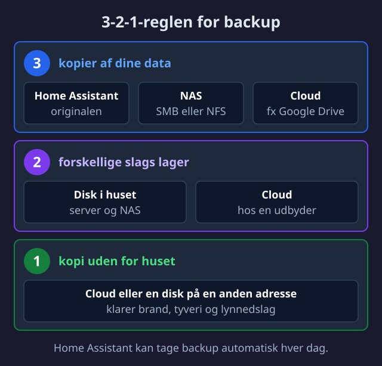

import { Card, CardGrid, Aside, Badge, Tabs, TabItem, Steps } from '@astrojs/starlight/components';
import FAQ from '../../../../components/FAQ.astro';

<Badge text="Backup" variant="danger" /> <Badge text="Sikkerhed" variant="caution" /> <Badge text="3-2-1" variant="success" />


Dit smart home er resultatet af mange timers arbejde. Automationer, integrationer, dashboards - alt kan være væk på et øjeblik hvis noget går galt. **Backup er ikke valgfrit** - det er nødvendigt.

---

## 🎯 3-2-1 Backup Reglen

Den gyldne standard for backup:




<Aside type="caution" title="Hvorfor off-site?">
Hvad nu hvis lynet slår ned og ødelægger både din HA-server OG din NAS? Med en off-site backup (cloud) er du stadig dækket.
</Aside>

---

## 🆕 Automatisk Backup (2025.1+)

Home Assistant 2025.1 introducerede et **helt nyt backup-system**:

### Nye Features

| Feature | Beskrivelse |
|---------|-------------|
| **Automatiske backups** | Planlagte backups uden apps eller andre tilføjelser |
| **Flere lokationer** | Cloud + NAS + lokal samtidig |
| **Kryptering** | Slået til som standard; kan slås fra pr. lokation (ikke for Home Assistant Cloud) |
| **Retention policies** | Automatisk sletning af gamle backups |
| **Nem opsætning** | Wizard til hurtig konfiguration |

### Opsæt Automatisk Backup

<Steps>
1. Gå til **Indstillinger → System → Backups**

2. Klik **Konfigurer automatiske backups**

3. Vælg tidsplan:
   - Dagligt eller udvalgte ugedage (**Brugerdefinerede dage**, på engelsk Custom days)
   - Tidspunkt (f.eks. kl. 04:00)

4. Vælg retention:
   - Antal backups eller antal dage, de gemmes (f.eks. 3 backups)

5. Vælg lokationer:
   - Lokal
   - Google Drive
   - OneDrive
   - Home Assistant Cloud
   - NAS (SMB/NFS)

6. Vælg kryptering:
   - **GEM DIN KRYPTERINGSNØGLE!** (Password manager)

7. Klik **Gem**
</Steps>

<Aside type="danger" title="Vigtigt!">
Hvis du mister din krypteringsnøgle, kan du **ikke** gendanne dine backups. Home Assistant lader dig hente nøglen som en tekstfil ("emergency kit"). Gem den et sikkert sted - gerne flere steder.
</Aside>

---

## ☁️ Cloud Backup Lokationer

### Google Drive (Native 2025.2+)

<Steps>
1. Opret egne Google OAuth-legitimationsoplysninger (Client ID og Client Secret) i Google Cloud Console, og aktivér Google Drive API. Redirect-URI'en er `https://my.home-assistant.io/redirect/oauth`. Følg trinene i [Home Assistants dokumentation](https://www.home-assistant.io/integrations/google_drive/)

2. Gå til **Indstillinger → Enheder & Tjenester**

3. Klik **Tilføj Integration** → søg "Google Drive"

4. Indtast Client ID og Client Secret, og giv adgang til din Google-konto

5. Vælg Google Drive som backup-lokation under de automatiske backupindstillinger

6. Backups gemmes i mappen "Home Assistant" med en undermappe for hver Home Assistant-installation
</Steps>

**Gratis lagerplads:** 15 GB (delt med Gmail og Photos)

### OneDrive (Native 2025.2+)

Tilføj OneDrive-integrationen under **Indstillinger → Enheder & Tjenester**. Som standard leverer Home Assistant selv klient-id og hemmelighed, og du logger ind hos Microsoft. Kun personlige OneDrive-konti understøttes.

### Home Assistant Cloud (Nabu Casa)

Hvis du abonnerer på Home Assistant Cloud:

<Steps>
1. Gå til **Indstillinger → Home Assistant Cloud**

2. Cloud backup er automatisk tilgængelig

3. Backups er **altid krypterede** (kan ikke slås fra)

4. Tilføj som backup-lokation under Backups
</Steps>

**Pris:** €7,50 om måneden eller €75 om året ifølge [Nabu Casa](https://www.nabucasa.com/pricing/), ekskl. moms. Prisen inkluderer fjernadgang og Alexa/Google-integration. Cloud gemmer én backup på højst 5 GB. Nabu Casa omdøber tjenesten til Home Assistant Link den 2. december.

---

## 🗄️ NAS Backup (SMB/NFS)

### Forbered NAS

<Tabs>
  <TabItem label="Synology">
    <Steps>
    1. Åbn **Control Panel → User & Group**
    
    2. Opret bruger til Home Assistant:
       - Brugernavn: `homeassistant`
       - Stærkt password
       - Deaktiver adgang til DSM
    
    3. Åbn **Control Panel → Shared Folder**
    
    4. Opret delt mappe:
       - Navn: `ha-backups`
       - Giv HA-bruger fuld adgang
    
    5. Aktiver SMB under **File Services → SMB**
    </Steps>
  </TabItem>
  <TabItem label="TrueNAS/QNAP">
    Lignende proces:
    - Opret dedikeret bruger
    - Opret dedikeret share
    - Sæt rettighedertil read/write
    - Aktiver SMB/NFS
  </TabItem>
</Tabs>

### Tilføj NAS til Home Assistant

<Steps>
1. Gå til **Indstillinger → System → Storage**

2. Klik **Tilføj lagring** (Add storage), og vælg SMB/CIFS eller NFS

3. Udfyld:
   ```text
   Navn: NAS Backup
   Brug: Backup
   Server: 192.168.1.50  # Din NAS IP
   Type: SMB (eller NFS)
   Share: ha-backups
   Brugernavn: homeassistant
   Password: ****
   ```

4. Klik **Forbind**

5. Gå til **Backups → Lokationer** og tilføj NAS
</Steps>

---

## 🔐 Kryptering

### Hvornår Kryptere?

| Lokation | Anbefaling | Grund |
|----------|------------|-------|
| **Cloud** | ✅ Altid | Data forlader dit netværk |
| **Home Assistant Cloud** | 🔒 Automatisk | Kan ikke slås fra |
| **NAS (hjemme)** | ⚖️ Valgfrit | Lettere recovery uden |
| **USB-disk** | ✅ Ja | Kan mistes/stjæles |

### Krypteringsnøgle Håndtering

```text
# GEM DISSE STEDER:
1. Password Manager (1Password, Bitwarden, etc.)
2. Fysisk kopi i pengeskab/sikkerhedsboks
3. Delt med en betroet person

# GEM IKKE:
- I Home Assistant selv (mistes ved crash)
- I ukrypteret fil på NAS
- Kun i hovedet
```

---

## 📅 Backup Strategi

### Anbefalet Setup

| Backup Type | Frekvens | Retention | Lokation |
|-------------|----------|-----------|----------|
| **Daglig** | Hver nat kl. 04:00 | 3 stk | Lokal |
| **Ugentlig** | Søndag kl. 04:00 | 4 stk | NAS + Cloud |
| **Før opdatering** | Ved hver HA opdatering | 3 stk | Alle lokationer |

### Konfigurer Differentierede Backups

```yaml
# Automatisk backup konfiguration
# Indstillinger → System → Backups → Automatisk backup

Tidsplan:
  Frekvens: Daglig
  Tid: 04:00
  Dag: Alle dage

Retention:
  Antal kopier: 3

Lokationer:
  - Lokal (krypteret: nej)
  - Google Drive (krypteret: ja)
  - NAS (krypteret: nej)

Ved opdateringer:
  Opret backup: Ja
```

---

## 🔄 Gendannelse (Restore)

### Fra Backup UI

<Steps>
1. Gå til **Indstillinger → System → Backups**

2. Find backup (fra lokal, cloud, eller NAS)

3. Klik på backup → **Gendan**

4. Vælg, hvad der skal gendannes (Select what to restore):
   - Home Assistant-indstillinger
   - Historik, medier, share-mappe og lokale apps
   - Apps (alle, ingen eller udvalgte)

5. Vent på gendannelse (store installationer kan tage omkring 45 minutter). Sluk ikke strømmen undervejs

6. Log ind igen efter genstart
</Steps>

### Disaster Recovery (Ny Installation)

Hvis din HA-server er totalt død:

<Steps>
1. **Installer Home Assistant** på ny hardware

2. Kør gennem initial setup

3. **Monter backup-lokation:**
   - NAS: Tilføj netværkslagring
   - Google Drive: Installer integration
   - USB: Tilslut disk

4. Gå til **Indstillinger → System → Backups**

5. Find backup fra din lokation

6. **Gendan fuld backup**

7. Genstart og log ind med dine gamle credentials
</Steps>

<Aside type="tip" title="Cross-platform restore">
Home Assistant backups virker på tværs af CPU-arkitekturer! Du kan gendanne en backup fra Raspberry Pi på en x86 server og omvendt.
</Aside>

---

## 🛡️ Sikkerhed Best Practices

### Netværkssikkerhed

| Praksis | Implementering |
|---------|----------------|
| **Separat VLAN** | IoT-enheder i eget netværk |
| **Firewall** | Blokér unødvendig trafik |
| **Ingen port forwarding** | Brug VPN eller Nabu Casa |
| **HTTPS** | SSL/TLS på al trafik |

### Home Assistant Sikkerhed

```yaml
# configuration.yaml
http:
  ssl_certificate: /ssl/fullchain.pem
  ssl_key: /ssl/privkey.pem
  ip_ban_enabled: true
  login_attempts_threshold: 5
```

### Bruger Sikkerhed

| Praksis | Beskrivelse |
|---------|-------------|
| **Stærke passwords** | 16+ tegn, password manager |
| **2FA** | Aktiver for alle brugere |
| **Least privilege** | Giv kun nødvendige rettigheder |
| **Separate konti** | Én per husstand, admin separat |

### Aktiver 2FA

<Steps>
1. Gå til din **Brugerprofil** (nederst til venstre)

2. Åbn fanen **Sikkerhed** og find **Multifaktor-godkendelsesmoduler** (Multi-factor authentication modules)

3. Aktiver **Authenticator app** (TOTP)

4. Scan QR-kode med authenticator app:
   - Google Authenticator
   - Authy
   - 1Password

5. Indtast kode for at bekræfte
</Steps>

---

## 🔧 Fejlfinding

### Backup Fejler

```yaml
# Tjek:
1. Er der nok plads på destinations-disk?
2. Er netværksforbindelse stabil (NAS)?
3. Er credentials korrekte (cloud/NAS)?
4. Check Supervisor logs for detaljer
```

### Gendannelse Fejler

```yaml
# Tjek:
1. Er backup'en korrupt? (prøv anden backup)
2. Er krypteringsnøgle korrekt?
3. Er HA version kompatibel?
4. Har du nok diskplads?
```

### NAS Mount Fejler

```yaml
# Almindelige problemer:
1. SMB version mismatch → Prøv SMB 2.0 eller 3.0
2. Forkerte credentials → Tjek brugernavn/password
3. Share eksisterer ikke → Tjek share-navn på NAS
4. Firewall blokerer → Port 445 (SMB) skal være åben
```

---

## 📋 Tjekliste

### Ugentlig

- [ ] Verificer at automatisk backup kører
- [ ] Tjek backup-status i UI
- [ ] Sørg for plads på backup-lokationer

### Månedlig

- [ ] Test gendannelse på testserver (hvis mulig)
- [ ] Tjek at krypteringsnøgle er tilgængelig
- [ ] Ryd op i gamle/unødvendige backups

### Ved Større Ændringer

- [ ] Opret manuel backup FØR ændringer
- [ ] Test backup efter store opdateringer
- [ ] Dokumentér ændringer

---

## ❓ Ofte Stillede Spørgsmål

<FAQ questions={[
  {
    question: "Hvor ofte skal jeg tage backup?",
    answer: "Minimum ugentligt, gerne dagligt. Med det nye automatiske backup-system er der ingen grund til ikke at køre daglige backups. Husk også backup før opdateringer."
  },
  {
    question: "Kan jeg gendanne på anden hardware?",
    answer: "Ja! Home Assistant backups er cross-platform og virker på tværs af CPU-arkitekturer. Du kan gå fra Raspberry Pi til Intel NUC uden problemer."
  },
  {
    question: "Hvad inkluderer en backup?",
    answer: "Det afhænger af, hvad du vælger. Home Assistant-indstillinger (konfiguration, automationer, dashboards) er altid med i automatiske backups. Historik, medier, share-mappen og apps med deres data kan vælges til. Logs og cache indgår ikke, og eksterne databaser som MariaDB eller PostgreSQL er kun med, hvis de kører som app på Home Assistant OS."
  },
  {
    question: "Skal jeg bruge kryptering på lokal backup?",
    answer: "Det er valgfrit for lokale/NAS backups. Fordelen ved ukrypterede backups er at du manuelt kan udtrække filer uden Home Assistant. Cloud backups bør altid være krypterede."
  }
]} />

---

## 📚 Næste Trin

<CardGrid>
  <Card title="Dashboard Design" icon="laptop">
    Byg smukke dashboards.
    
    [Se guide →](/da/home-assistant/dashboard-design/)
  </Card>
  <Card title="Node-RED" icon="rocket">
    Avancerede automationer.
    
    [Se guide →](/da/home-assistant/node-red/)
  </Card>
</CardGrid>

---

*Sidst opdateret: November 2026*
