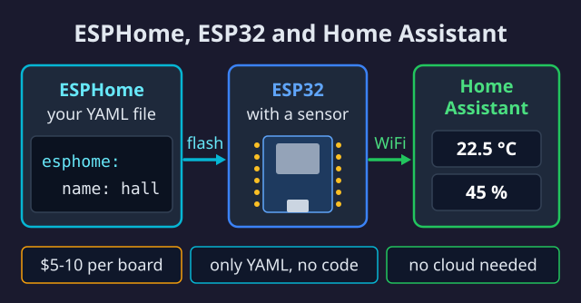
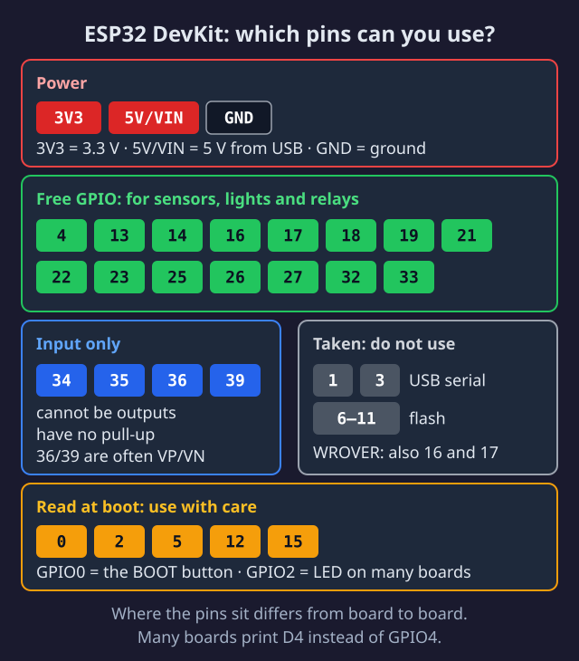

import { Steps, Aside, Tabs, TabItem, Card, CardGrid, Badge } from '@astrojs/starlight/components';

<Badge text="Easy" variant="success" /> <Badge text="20 min" variant="note" /> <Badge text="$5-10" variant="caution" />

ESP32 is a microcontroller - a small computer that can measure things, control things, and talk to your WiFi. Together with ESPHome, it becomes easy to build your own smart home devices.



## 📋 Prerequisites

Before you start, you need:

- ✅ [Home Assistant running](/en/home-assistant/)
- ✅ A computer with USB port
- ✅ Chrome or Edge browser (for USB flash)

## 🤔 What is ESPHome?

ESPHome is software that runs on your ESP32. You describe what it should do in a simple YAML file, and ESPHome handles the rest.

**Benefits:**
- No Arduino IDE or C++ programming
- Direct integration with Home Assistant
- Wireless updates (OTA)

## 🛒 Choose Your Board

| Board | Price | Recommended for |
|-------|-------|-----------------|
| **ESP32-WROOM-32 DevKit** | $5-10 | ⭐ Beginners (start here) |
| ESP32-C3 Super Mini | $3-5 | Small projects |
| ESP32-S3 | $8-12 | Displays, more RAM |

<Aside type="tip">
Start with a **WROOM-32 DevKit**. It's wide enough to see what you're doing, and all our guides use it.
</Aside>

### ESP32 Pinout Overview



## ⚙️ Install ESPHome Add-on

<Steps>
1. **Open Home Assistant** and go to **Settings** → **Apps** (formerly called **Add-ons**)

2. Open the store (bottom right)

3. Search for **"ESPHome"** and click on it

4. Click **Install** and wait (1-2 minutes)

5. Enable **"Start on boot"** and **"Show in sidebar"**

6. Click **Start**
</Steps>

<Aside type="note">
The ESPHome icon now appears in your sidebar on the left.
</Aside>

## 🔌 Create Your First Device

<Steps>
1. **Open ESPHome** from the sidebar

2. Click **+ NEW DEVICE**

3. Click **Continue** (ignore browser-flash for now)

4. **Name the device** - e.g., `test-sensor`
   
   <Aside type="caution">
   Use only lowercase letters, numbers, and hyphens. No spaces or special characters.
   </Aside>

5. Select **ESP32** as device type

6. Click **Skip** (we'll flash manually afterwards)
</Steps>

## 📝 Configure the Device

Click **EDIT** on your new device and replace the content with:

```yaml title="test-sensor.yaml"
esphome:
  name: test-sensor
  friendly_name: Test Sensor

esp32:
  board: esp32dev

# Logging for debugging
logger:

# Home Assistant API
api:
  encryption:
    key: "YOUR-AUTO-GENERATED-KEY"

# Wireless updates
ota:
  - platform: esphome

# WiFi connection
wifi:
  ssid: "YOUR-WIFI-NAME"
  password: "YOUR-WIFI-PASSWORD"
  # Fallback hotspot if WiFi fails (captive_portal requires ap)
  ap:
    ssid: "Test Sensor Fallback"
    password: "YOUR-FALLBACK-PASSWORD"

captive_portal:

# Simple test sensor - WiFi signal strength
sensor:
  - platform: wifi_signal
    name: "WiFi Signal"
    update_interval: 60s
```

<Aside type="tip">
Replace `YOUR-WIFI-NAME` and `YOUR-WIFI-PASSWORD` with your actual WiFi credentials.
</Aside>

## 📤 Flash to ESP32

<Tabs>
  <TabItem label="🌐 Web (easiest)">
    <Steps>
    1. Connect ESP32 to computer with USB cable
    
    2. Click **INSTALL** → **Plug into this computer**
    
    3. Select **"Serial"** in the popup window
    
    4. Select the correct COM port (typically the only one shown)
    
    5. Wait for upload (~2 minutes)
    
    6. You'll see "INFO Successfully uploaded" when done
    </Steps>
    
    <Aside type="caution">
    Only works in **Chrome** or **Edge**. Firefox doesn't support Web Serial.
    </Aside>
  </TabItem>
  <TabItem label="💻 ESPHome CLI">
    If web-flash doesn't work:
    
    ```bash
    # Install ESPHome CLI
    pip install esphome
    
    # Flash via USB
    esphome run test-sensor.yaml
    ```
  </TabItem>
</Tabs>

## ✅ Add to Home Assistant

<Steps>
1. Go to **Settings** → **Devices & Services**

2. Home Assistant automatically finds your ESP32 under **"Discovered"**

3. Click **Configure**

4. Enter your encryption key (from the YAML file)

5. Click **Submit** → **Finish**
</Steps>

Your ESP32 is now connected! 🎉

## 🧪 Test It Works

<Steps>
1. Go to **Settings** → **Tools** → **States**

2. Search for `sensor.test_sensor_wifi_signal`

3. You should see a value like `-45 dBm`
</Steps>

<Aside type="tip" title="WiFi signal strength">
- **-30 to -50 dBm:** Excellent
- **-50 to -70 dBm:** Good
- **-70 to -80 dBm:** Weak
- **Below -80 dBm:** Unstable
</Aside>

## 🔧 Troubleshooting

<Aside type="tip" title="ESP32 not found?">
- Try a different USB cable (some are charge-only)
- Try a different USB port
- Install CH340 driver: [Windows](https://sparks.gogo.co.nz/ch340.html) / [Mac](https://github.com/adrianmihalko/ch340g-ch34g-ch34x-mac-os-x-driver)
</Aside>

<Aside type="tip" title="WiFi won't connect?">
- Double-check SSID and password (case-sensitive)
- The boards in this guide (WROOM-32, C3, S3) use 2.4 GHz WiFi; 5 GHz requires a newer chip such as the ESP32-C5
- Try being closer to the router
</Aside>

<Aside type="tip" title="Home Assistant doesn't find the device?">
- Check that ESP32 and HA are on the same network
- Restart the ESPHome add-on
- Check ESPHome logs for errors
</Aside>

## 🚀 Next Steps

<CardGrid>
  <Card title="🌡️ Temperature Sensor" icon="rocket">
    Add a DHT22 and measure temperature/humidity.
    
    [Build temperature sensor →](/en/esp32/temperatur-sensor/)
  </Card>
  <Card title="🚶 Motion Sensor" icon="setting">
    Add a PIR sensor for motion detection.
    
    [Build motion sensor →](/en/esp32/bevaegelsessensor/)
  </Card>
</CardGrid>
