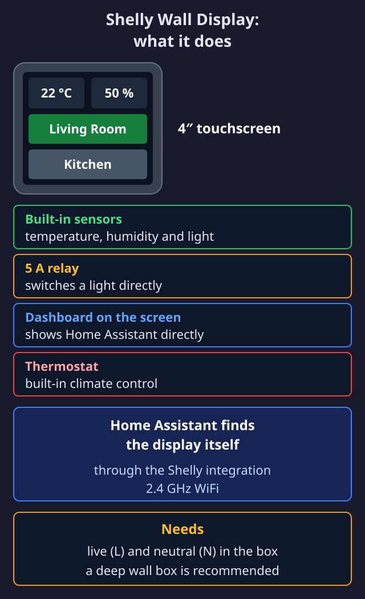

import { Steps, Aside, Tabs, TabItem, Card, CardGrid, Badge } from '@astrojs/starlight/components';

<Badge text="Medium" variant="caution" /> <Badge text="30 min" variant="note" />


Shelly Wall Display (model SAWD1) is a 4" touchscreen with built-in sensors and relay. Shelly also has newer models (Wall Display X2, X1i, X2i and XL); this guide covers the first model. It can show Home Assistant dashboards directly on the screen - perfect as a control panel in kitchen, hallway or bedroom.



## 🤔 What is Shelly Wall Display?

Shelly Wall Display is an all-in-one solution that combines:

| Feature | Specification |
|---------|---------------|
| **Screen** | 4" IPS touchscreen (480x480) |
| **Sensors** | Temperature, humidity, brightness (LUX) |
| **Relay** | 5A built-in switch |
| **Connection** | WiFi 2.4GHz |
| **Power** | 230V AC, 50/60 Hz (requires neutral) |
| **Mounting** | Standard wall box |

<Aside type="tip" title="Why Shelly Wall Display?">
- **Native HA support** - Show dashboards directly on screen
- **No hub** - Connects directly to your WiFi
- **Built-in sensors** - Temperature/humidity for automations
- **5A relay** - Can control lights directly
</Aside>

## 📦 What You Need

- Shelly Wall Display (~$80-100)
- Standard wall box (deep model recommended)
- Power supply with **neutral wire**
- Home Assistant installation

<Aside type="caution" title="Requires neutral!">
Shelly Wall Display requires live (L) and neutral (N). Older installations without neutral at the switch will NOT work.
</Aside>

## ⚡ Installation

### Step 1: Physical Mounting

<Steps>
1. **Turn off power** at the breaker
2. **Verify** with voltage tester that there's no power
3. **Connect wires:**
   - L (live) → L terminal
   - N (neutral) → N terminal
   - The lamp, or whatever the built-in relay should switch → O terminal (optional)
   - An existing switch or push button → SW terminal (optional)

   The display has no ground terminal. If there is a ground wire (green/yellow) in the box, it must stay connected onwards to the lamp as before.
4. **Mount the display** in wall box
5. **Turn on power**
</Steps>

### Step 2: WiFi Setup

<Steps>
1. Display starts in AP mode on first boot
2. Connect to WiFi network **ShellyWallDisplay-XXXX** from your phone
3. Open **192.168.33.1** in browser
4. Select your home network and enter password
5. Display restarts and connects to your WiFi
</Steps>

### Step 3: Add to Home Assistant

Home Assistant automatically finds Shelly devices:

<Steps>
1. Go to **Settings** → **Devices & services**
2. Shelly Wall Display should be under **Discovered**
3. Click **Configure** and follow the wizard
4. Device is added with all sensors
</Steps>

## 📊 Entities in Home Assistant

After adding you get these entities:

| Entity | Type | Description |
|--------|------|-------------|
| `climate.shelly_wall_display` | Thermostat | Built-in thermostat function |
| `sensor.shelly_wall_display_temperature` | Sensor | Room temperature |
| `sensor.shelly_wall_display_humidity` | Sensor | Humidity |
| `switch.shelly_wall_display` | Switch | The 5A relay |

## 📱 Show Home Assistant Dashboard on Screen

This is the really smart feature - you can show an HA dashboard directly on Wall Display!

### Step 1: Update Firmware

<Steps>
1. Find display's IP address (via router or HA)
2. Open **http://[IP-ADDRESS]** in browser
3. Go to **Settings** → **Firmware**
4. Update to at least **version 2.3.0** or newer
</Steps>

### Step 2: Enable Home Assistant Integration

<Steps>
1. On Wall Display, go to **Settings** → **Network**
2. Tap **Home Assistant**
3. You'll be asked to update - tap **Yes**
4. Wait a few minutes (it's a large update)
5. Go back to **Settings** → **Network** → **Home Assistant**
6. Select your Home Assistant server from the list
7. Tap **Save**
</Steps>

### Step 3: Create a Dedicated Dashboard

Create a simple dashboard optimized for the small screen:

```yaml
title: Wall Display
views:
  - title: Home
    type: panel
    cards:
      - type: vertical-stack
        cards:
          # Temperature and humidity
          - type: horizontal-stack
            cards:
              - type: entity
                entity: sensor.shelly_wall_display_temperature
                name: Temp
              - type: entity
                entity: sensor.shelly_wall_display_humidity
                name: Humidity
          
          # Quick buttons
          - type: horizontal-stack
            cards:
              - type: button
                entity: light.living_room
                name: Living Room
                tap_action:
                  action: toggle
              - type: button
                entity: light.kitchen
                name: Kitchen
                tap_action:
                  action: toggle
          
          # Thermostat
          - type: thermostat
            entity: climate.shelly_wall_display
```

### Step 4: Kiosk Mode (Recommended)

Kiosk Mode is a HACS integration that hides Home Assistant's navigation bar, sidebar and other UI elements. This gives a clean, fullscreen dashboard - perfect for wall-mounted displays.

<Aside type="note" title="Open Source">
Kiosk Mode is open source! Check out the [Kiosk Mode GitHub](https://github.com/NemesisRE/kiosk-mode) for documentation and configuration options.
</Aside>

#### Installation via HACS

<Steps>
1. Open **Settings → Marketplace** (HACS before Home Assistant 2026.11)
2. Search for **Kiosk Mode**
3. Select **Install**
4. **Restart Home Assistant**
5. Clear browser cache or hard refresh (Ctrl+Shift+R)
</Steps>

#### Method 1: URL Parameter (Simple)

Add `?kiosk` to your dashboard URL:

```
http://192.168.1.190:8123/dashboard-wall-display?kiosk
```

**Other URL parameters:**
- `?hide_header` - Hide only header
- `?hide_sidebar` - Hide only sidebar
- `?kiosk&cache` - Save setting in browser cache

## 🌡️ Use Sensors in Automations

### Example: Turn on Ventilation at High Humidity

```yaml
automation:
  - alias: "Turn on ventilation at high humidity"
    triggers:
      - trigger: numeric_state
        entity_id: sensor.shelly_wall_display_humidity
        above: 65
        for:
          minutes: 5
    actions:
      - action: switch.turn_on
        entity_id: switch.ventilation
```

### Example: Night Lighting Based on Light Level

```yaml
automation:
  - alias: "Dim light in evening"
    triggers:
      - trigger: numeric_state
        entity_id: sensor.shelly_wall_display_illuminance
        below: 50
    conditions:
      - condition: time
        after: "18:00:00"
        before: "23:00:00"
    actions:
      - action: light.turn_on
        entity_id: light.living_room_accent
        data:
          brightness_pct: 30
```

## 📐 Optimal Dashboard Design

Tips for dashboards that work well on the 480x480 screen:

| Recommendation | Why |
|----------------|-----|
| **Use large buttons** | Easier to tap with finger |
| **Max 6-8 elements** | Screen is small |
| **Avoid scrolling** | Works poorly on device |
| **Use icons** | More intuitive than text |
| **High contrast** | Better readability |

## 🔧 Troubleshooting

<Aside type="tip" title="Screen doesn't show HA dashboard?">
1. Check firmware is at least 2.3.0
2. Verify HA URL is correct (including port 8123)
3. Ensure Wall Display and HA are on same network/VLAN
4. Try restarting the display
</Aside>

<Aside type="tip" title="Sensors show wrong values?">
- Temperature can be 1-2°C higher due to screen heat
- Don't place display in direct sunlight
- Wait 30 min after installation before reading
</Aside>

## 🚀 Next Steps

<CardGrid>
  <Card title="🌡️ Better Thermostat" icon="setting">
    Combine with intelligent heating control.
    
    [Set up Better Thermostat →](/en/home-assistant/better-thermostat/)
  </Card>
  <Card title="⚡ Automations" icon="rocket">
    Create automations based on sensor data.
    
    [Your first automation →](/en/home-assistant/foerste-automation/)
  </Card>
</CardGrid>
